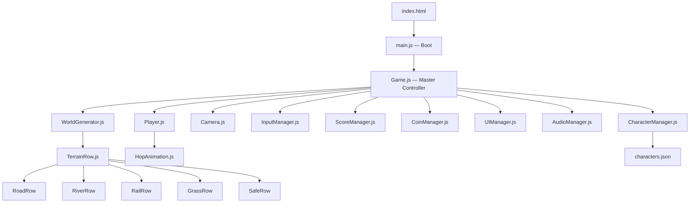
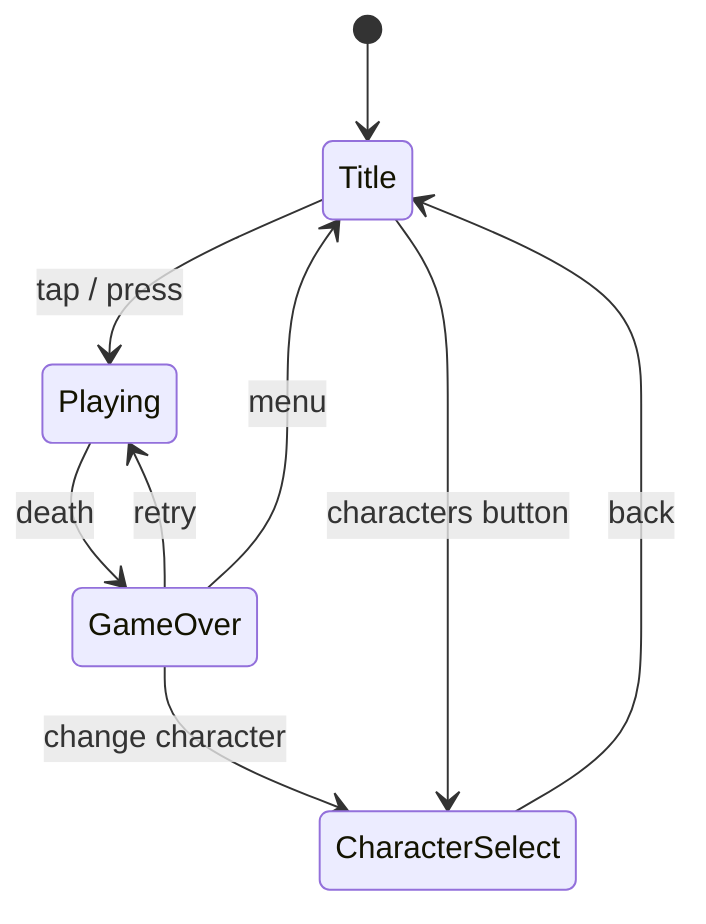

# Crossy Road Web Game — Implementation Plan

## Goal
Build a fully playable, web-based **Crossy Road clone** with a voxel art style, rendered in the browser using Three.js. The game replicates the core endless-arcade-hopper experience: tile-based forward hopping across procedurally generated terrain strips, multiple hazard types, 100+ unlockable characters that change world themes, a coin economy with gumball-machine gacha, persistent high scores, and satisfying "juice" (animations, sound, slapstick deaths).

---

## User Review Required

> [!IMPORTANT]
> **Scope & Phasing** — This is a large game. The plan is structured into **4 phases** so you can play-test and give feedback after each phase ships a runnable build. Phase 1 alone produces a fully playable hop-and-dodge game. Should we ship all 4 phases, or cut scope?

> [!IMPORTANT]
> **Monetization / Ads** — The real Crossy Road uses video-reward ads and IAP. This plan implements only the coin + gumball economy with no real payments. Want a placeholder ad-reward button?

> [!IMPORTANT]
> **Mobile vs Desktop** — The plan supports both (tap/swipe on mobile, arrow keys / WASD on desktop). Confirm this is desired or if you want to target only one platform.

> [!IMPORTANT]
> **Sound & Music** — Plan includes procedural SFX via Tone.js and ambient background music. Do you want full audio, or should we start silent and add audio later?

## Open Questions

1. **Deployment target** — Will this be hosted (Netlify / Vercel / GitHub Pages), or local-only for now?
2. **Character art** — Should characters be code-generated voxel primitives (cubes/spheres assembled in code), or do you want to import `.glb`/`.gltf` models later?
3. **Leaderboard** — Local-only (localStorage) or online (would need a backend)?

---

## Technical Stack

| Layer | Choice | Why |
|---|---|---|
| **Renderer** | Three.js r170+ | Best voxel performance, InstancedMesh, massive community |
| **Bundler** | Vite 6 | Instant HMR, tree-shaking, zero config |
| **Language** | Vanilla JavaScript (ES Modules) | Zero framework overhead, maximum portability |
| **Audio** | Tone.js | Procedural SFX without needing audio assets |
| **State** | Plain JS classes + localStorage | No Redux/Zustand needed for a game this shape |
| **Physics** | Custom tile-based (no engine) | Crossy Road has no continuous physics — just grid snaps |

---

## Architecture Overview



### Directory Structure

```
d:\Vibe\
├── index.html
├── package.json
├── vite.config.js
├── public/
│   └── favicon.ico
└── src/
    ├── main.js                  # Entry point
    ├── Game.js                  # Master game loop & state machine
    ├── constants.js             # Grid size, speeds, colors, tuning knobs
    │
    ├── world/
    │   ├── WorldGenerator.js    # Procedural row spawner
    │   ├── TerrainRow.js        # Base class for all row types
    │   ├── GrassRow.js          # Trees, rocks, bushes
    │   ├── RoadRow.js           # Cars, trucks
    │   ├── RiverRow.js          # Logs, lily pads
    │   ├── RailRow.js           # Train tracks
    │   ├── SafeRow.js           # Rest rows (no hazards)
    │   └── themes.js            # Theme definitions (colors, props per biome)
    │
    ├── entities/
    │   ├── Player.js            # Position, hop logic, death states
    │   ├── Vehicle.js           # Car/truck meshes & movement
    │   ├── Log.js               # Floating log meshes & movement
    │   ├── Train.js             # Train entity
    │   ├── Eagle.js             # Anti-idle eagle swoop
    │   └── Coin.js              # Collectible coin entity
    │
    ├── characters/
    │   ├── CharacterManager.js  # Unlock/select/render characters
    │   ├── CharacterFactory.js  # Builds voxel meshes for each character
    │   └── characters.json      # Character catalog (name, colors, theme, unlock cost)
    │
    ├── systems/
    │   ├── InputManager.js      # Keyboard + touch/swipe
    │   ├── CameraController.js  # Isometric follow cam with smooth lerp
    │   ├── CollisionSystem.js   # Grid-based hit detection
    │   ├── ScoreManager.js      # Current score, high score (localStorage)
    │   ├── CoinManager.js       # Coin balance, spending
    │   ├── AudioManager.js      # SFX + music via Tone.js
    │   └── ParticleSystem.js    # Death splats, hop dust, coin sparkle
    │
    ├── ui/
    │   ├── UIManager.js         # HUD overlay controller
    │   ├── screens/
    │   │   ├── TitleScreen.js
    │   │   ├── GameOverScreen.js
    │   │   ├── CharacterSelectScreen.js
    │   │   └── GumballScreen.js
    │   └── components/
    │       ├── ScoreDisplay.js
    │       ├── CoinCounter.js
    │       └── Button.js
    │
    └── utils/
        ├── mathHelpers.js       # Lerp, clamp, random range
        ├── meshFactory.js       # Shared voxel box/cylinder builders
        └── objectPool.js        # Reusable mesh pool to avoid GC
```

---

## Phase 1 — Core Gameplay (Fully Playable MVP)

> **Deliverable:** Hop across roads and grass. Cars kill you. Score counts. High score saves. Works on desktop + mobile.

### [NEW] `package.json`
```json
{
  "name": "crossy-road-web",
  "private": true,
  "type": "module",
  "scripts": {
    "dev": "vite",
    "build": "vite build",
    "preview": "vite preview"
  },
  "dependencies": {
    "three": "^0.170.0"
  },
  "devDependencies": {
    "vite": "^6.0.0"
  }
}
```

### [NEW] `vite.config.js`
```js
import { defineConfig } from 'vite';
export default defineConfig({
  root: '.',
  publicDir: 'public',
  build: { outDir: 'dist' }
});
```

### [NEW] `index.html`
- Full-viewport `<canvas>` with CSS reset
- HUD overlay div for score / coins / buttons
- Meta viewport for mobile
- Touch-action: none to prevent scroll on swipe

### [NEW] `src/constants.js`
Key tuning values:
```js
export const TILE_SIZE = 1;
export const ROWS_VISIBLE_AHEAD = 20;
export const ROWS_VISIBLE_BEHIND = 5;
export const ROW_TYPES = ['grass', 'road', 'road', 'grass', 'road'];
export const CAR_SPEEDS = [0.02, 0.03, 0.04, 0.05];
export const EAGLE_IDLE_TIME = 4000; // ms
export const HOP_DURATION = 120; // ms
export const CAMERA_ANGLE = { x: -60, y: 45 }; // degrees
```

### [NEW] `src/Game.js` — State Machine



Core loop:
1. `update(dt)` — move vehicles, check collisions, update camera, check eagle timer
2. `render()` — Three.js render call
3. State transitions pause/resume relevant systems

### [NEW] `src/world/WorldGenerator.js`
- Maintains a ring buffer of ~25 `TerrainRow` instances
- As player advances, old rows behind are recycled into new rows ahead
- Row type selection: weighted random, never >3 roads in a row, guaranteed safe row every 8–12 rows
- Each row is a `THREE.Group` positioned at `z = rowIndex * TILE_SIZE`

### [NEW] `src/world/RoadRow.js`
- Spawns 1–3 vehicles per lane
- Vehicles move left or right at `CAR_SPEEDS[random]`
- Vehicles wrap around when they exit the visible range (±8 tiles)
- Vehicle meshes: colored boxes (voxel trucks = 2×1×1, cars = 1×0.7×1)

### [NEW] `src/world/GrassRow.js`
- Random placement of tree and rock obstacles (voxel shapes)
- Trees: green box on brown cylinder
- Rocks: gray flattened box
- Obstacles block player movement (collision)

### [NEW] `src/entities/Player.js`
- Grid position `{x, z}` (integers)
- `hop(direction)` → tween from current tile to next tile over `HOP_DURATION` ms
- Hop animation: scale squash on launch, stretch at apex, squash on land
- Mesh: default chicken = yellow box body + white box head + orange beak + red comb (all `THREE.Mesh` children of a `Group`)
- Death states: `squished` (flatten Y scale), `drowned` (sink + splash), `eagled` (lift off screen)

### [NEW] `src/systems/InputManager.js`
- **Desktop:** ArrowUp / W = hop forward, ArrowLeft / A = hop left, ArrowRight / D = hop right, ArrowDown / S = hop back
- **Mobile:** Tap top half = forward, swipe left/right/down for sides/back
- Debounce: ignore input while hop animation is playing
- All inputs emit events: `input:hop-forward`, `input:hop-left`, etc.

### [NEW] `src/systems/CameraController.js`
- Isometric perspective camera at ~60° elevation, 45° rotation
- Smoothly lerps to follow player Z position
- X follows player with slight lag for cinematic feel
- FOV and distance tuned for "Crossy Road look"

### [NEW] `src/systems/CollisionSystem.js`
- After each hop completes, check:
  - Is player on a road tile? → check vehicle bounding boxes vs player tile
  - Is player on a river tile? → check if standing on a log, else drown
  - Is player on a rail tile? → check if train is passing
  - Is target tile blocked by obstacle? → prevent hop
- Continuous check each frame for vehicles that move into the player's tile mid-frame

### [NEW] `src/systems/ScoreManager.js`
- Score = max Z position reached
- High score persisted to `localStorage`
- Emits events: `score:update`, `score:new-high`

### [NEW] `src/ui/screens/TitleScreen.js`
- HTML overlay: game title, "TAP TO PLAY" prompt, high score display, character select button
- Voxel chicken idle animation in 3D background

### [NEW] `src/ui/screens/GameOverScreen.js`
- Score / high score comparison
- "NEW HIGH SCORE!" flash animation
- Retry button, menu button

---

## Phase 2 — Rivers, Rails, & Eagle

> **Deliverable:** Full hazard variety. Rivers with logs, train tracks, and the anti-idle eagle.

### [NEW] `src/world/RiverRow.js`
- Blue water plane
- Spawns 2–4 logs (brown boxes) moving horizontally
- Logs have varied lengths (2–4 tiles) and speeds
- Player standing on water without a log → drown death
- Player on a log → carried sideways each frame; if carried off-screen → drown

### [NEW] `src/world/RailRow.js`
- Track mesh with warning lights (small red spheres that blink)
- Train spawns off-screen after warning, crosses at high speed
- Audio cue: bell + horn
- Player on track when train passes → instant death

### [NEW] `src/entities/Eagle.js`
- Timer starts when player hasn't moved for `EAGLE_IDLE_TIME`
- Eagle mesh descends from above, shadow grows on ground
- Grabs player, lifts off → game over
- Mesh: brown box body, triangle wings (simple voxel bird)

### [NEW] `src/systems/ParticleSystem.js`
- Hop dust: 4–6 small cubes burst from landing tile
- Death splat: red cubes spray on vehicle hit
- Water splash: blue cubes on drown
- Coin collect: golden sparkles

---

## Phase 3 — Characters, Coins, & Themes

> **Deliverable:** Coin collection, gumball machine unlock, 20+ characters, 5 world themes.

### [NEW] `src/entities/Coin.js`
- Golden spinning cube placed randomly on terrain (1 per ~5 rows)
- Collected on player overlap → coin count += 1
- Sparkle particle + sound effect

### [NEW] `src/characters/characters.json`
Catalog of 50+ characters in 5 theme groups:

| Theme | Example Characters | World Changes |
|---|---|---|
| **Classic** | Chicken, Duck, Dog, Cat, Frog | Green grass, gray roads |
| **Spooky** | Ghost, Vampire, Zombie, Witch | Purple fog, dark roads, pumpkin obstacles |
| **Arctic** | Penguin, Polar Bear, Seal, Walrus | Snow ground, ice rivers, snowflake particles |
| **Desert** | Cactus, Scorpion, Lizard, Camel | Sand ground, no rivers (replaced with quicksand) |
| **Neon** | Robot, UFO, Pixel Cat, Glitch | Black ground, neon grid lines, glowing vehicles |

### [NEW] `src/characters/CharacterFactory.js`
- Builds each character from a descriptor: body size, colors, head shape, accessories
- All built from primitive Three.js geometries (boxes, cylinders, cones)
- Returns a `THREE.Group` ready to attach to `Player`

### [NEW] `src/world/themes.js`
```js
export const THEMES = {
  classic: {
    sky: 0x87CEEB,
    grass: 0x4CAF50,
    road: 0x424242,
    water: 0x2196F3,
    treeColor: 0x2E7D32,
    fogDensity: 0,
  },
  spooky: {
    sky: 0x1a0a2e,
    grass: 0x2d1b4e,
    road: 0x1a1a2e,
    water: 0x4a0e78,
    treeColor: 0x4a148c,
    fogDensity: 0.03,
  },
  // ... arctic, desert, neon
};
```

### [NEW] `src/ui/screens/CharacterSelectScreen.js`
- Grid of character thumbnails (3D rendered to small canvases or shown as colored icons)
- Locked characters show silhouette + "?" 
- Unlocked characters are selectable
- Shows character name and theme

### [NEW] `src/ui/screens/GumballScreen.js`
- 3D gumball machine model (spheres in a glass cylinder)
- "INSERT 100 COINS" button
- Animation: crank turns, ball drops, character revealed
- If character already owned → "DUPLICATE" message, bonus 25 coins back

### [NEW] `src/systems/CoinManager.js`
- Total coins persisted to `localStorage`
- Tracks coins earned this run
- Spending API for gumball machine

---

## Phase 4 — Polish, Audio, & Advanced Features

> **Deliverable:** Full juice — audio, death cameras, dynamic difficulty, daily challenges.

### [NEW] `src/systems/AudioManager.js`
- **Hop sound:** Short percussive "tok" — pitch varies with hop speed
- **Coin sound:** Rising chime
- **Car horn:** Random when vehicle passes close
- **Train bell:** Warning before train
- **Eagle screech:** When eagle appears
- **Splat / splash:** Death sounds
- **Background music:** Simple looping chiptune melody (procedural via Tone.js)
- Mute toggle in UI

### Death Camera ("Polaroid Snapshot")
- On death, camera zooms to a dramatic angle
- Screen flashes white briefly
- Freeze frame with vignette effect
- Score overlay appears on top

### Dynamic Difficulty
- Speed of vehicles increases every 50 points
- River log gaps widen after 100 points
- Train frequency increases after 75 points
- Maximum difficulty cap at 200 points to stay fair

### Night/Day Cycle
- Ambient light color shifts gradually as score increases
- Street lamps appear on road rows at "night" scores
- Headlights on vehicles glow

### Performance Optimizations
- Object pooling for all vehicles, logs, particles
- Frustum culling: rows far behind player get meshes removed
- InstancedMesh for repetitive elements (trees, rocks, coins)
- requestAnimationFrame with delta-time for frame-rate independence

---

## Proposed Changes Summary

### Phase 1 Files (Core MVP)
| Status | File | Purpose |
|---|---|---|
| [NEW] | `package.json` | Dependencies & scripts |
| [NEW] | `vite.config.js` | Build config |
| [NEW] | `index.html` | Entry HTML with canvas + HUD overlay |
| [NEW] | `src/main.js` | Bootstrap |
| [NEW] | `src/constants.js` | All tuning values |
| [NEW] | `src/Game.js` | Master state machine & game loop |
| [NEW] | `src/world/WorldGenerator.js` | Procedural row manager |
| [NEW] | `src/world/TerrainRow.js` | Base row class |
| [NEW] | `src/world/GrassRow.js` | Grass + obstacles |
| [NEW] | `src/world/RoadRow.js` | Roads + vehicles |
| [NEW] | `src/world/SafeRow.js` | Safe rest rows |
| [NEW] | `src/entities/Player.js` | Player hop + mesh |
| [NEW] | `src/entities/Vehicle.js` | Car/truck entity |
| [NEW] | `src/systems/InputManager.js` | Keyboard + touch |
| [NEW] | `src/systems/CameraController.js` | Isometric follow cam |
| [NEW] | `src/systems/CollisionSystem.js` | Hit detection |
| [NEW] | `src/systems/ScoreManager.js` | Score + localStorage |
| [NEW] | `src/ui/UIManager.js` | HUD controller |
| [NEW] | `src/ui/screens/TitleScreen.js` | Title screen |
| [NEW] | `src/ui/screens/GameOverScreen.js` | Game over screen |
| [NEW] | `src/ui/components/ScoreDisplay.js` | Score HUD element |
| [NEW] | `src/utils/mathHelpers.js` | Lerp, clamp, random |
| [NEW] | `src/utils/meshFactory.js` | Voxel primitive builders |
| [NEW] | `src/utils/objectPool.js` | Mesh recycling |

### Phase 2 Files (Rivers, Rails, Eagle)
| Status | File |
|---|---|
| [NEW] | `src/world/RiverRow.js` |
| [NEW] | `src/world/RailRow.js` |
| [NEW] | `src/entities/Log.js` |
| [NEW] | `src/entities/Train.js` |
| [NEW] | `src/entities/Eagle.js` |
| [NEW] | `src/systems/ParticleSystem.js` |

### Phase 3 Files (Characters, Coins, Themes)
| Status | File |
|---|---|
| [NEW] | `src/entities/Coin.js` |
| [NEW] | `src/characters/CharacterManager.js` |
| [NEW] | `src/characters/CharacterFactory.js` |
| [NEW] | `src/characters/characters.json` |
| [NEW] | `src/world/themes.js` |
| [NEW] | `src/ui/screens/CharacterSelectScreen.js` |
| [NEW] | `src/ui/screens/GumballScreen.js` |
| [NEW] | `src/systems/CoinManager.js` |
| [NEW] | `src/ui/components/CoinCounter.js` |

### Phase 4 Files (Polish & Audio)
| Status | File |
|---|---|
| [NEW] | `src/systems/AudioManager.js` |
| [MODIFY] | Various — add audio hooks, difficulty scaling, night cycle, death cam |

---

## Verification Plan

### Automated Tests
```bash
# Build verification (no TypeScript errors, no missing imports)
cd d:\Vibe && npm run build

# Dev server runs without crash
cd d:\Vibe && npm run dev
```

### Manual Verification Checklist

**Phase 1:**
- [ ] Game loads in Chrome / Edge / Firefox
- [ ] Player hops in 4 directions with keyboard
- [ ] Player hops with tap/swipe on mobile (use Chrome DevTools device emulation)
- [ ] Vehicles move across road rows at varying speeds
- [ ] Collision with vehicle = death → Game Over screen
- [ ] Score increments on forward hop
- [ ] High score persists across page reloads
- [ ] World generates endlessly ahead
- [ ] Old rows behind player are cleaned up (no memory leak)
- [ ] Trees/rocks block movement
- [ ] Smooth camera follow

**Phase 2:**
- [ ] Rivers appear with moving logs
- [ ] Stepping in water without log = drown
- [ ] Riding a log carries player sideways
- [ ] Train tracks have warning lights + train passes
- [ ] Idle > 4 seconds = eagle swoops
- [ ] Particles on hop / death

**Phase 3:**
- [ ] Coins appear and can be collected
- [ ] Coin count persists in localStorage
- [ ] Gumball machine costs 100 coins and unlocks random character
- [ ] Selecting a themed character changes world colors/props
- [ ] Character select grid shows locked/unlocked status

**Phase 4:**
- [ ] Audio plays for all actions (hop, coin, death, etc.)
- [ ] Mute button works
- [ ] Difficulty ramps with score
- [ ] Death camera zoom effect triggers
- [ ] 60 FPS maintained at score 200+
