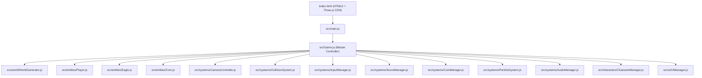

# Crossy Road 3D Voxel Web Game — Walkthrough

We have built a web-based **Crossy Road** clone featuring 3D voxel art style, endless procedural terrain generation, 50 unlockable characters across 5 biomes/themes, procedural Web Audio SFX, coin economy with a gumball machine, dynamic difficulty, and anti-idle mechanics.

---

## 🎮 How to Play

The local HTTP server is running at:
**[http://localhost:8080](http://localhost:8080)**

### Controls:
- **Desktop Keyboard:**
  - `ArrowUp` or `W` — Hop Forward
  - `ArrowDown` or `S` — Hop Backward
  - `ArrowLeft` or `A` — Hop Left
  - `ArrowRight` or `D` — Hop Right
- **Mobile / Touch:**
  - **Tap** screen to hop forward
  - **Swipe** in any of the 4 directions to hop that way

---

## 🛠️ Architecture & Systems Delivered

### 1. Procedural World Generation (`src/world/`)
- [WorldGenerator.js](file:///d:/Vibe/src/world/WorldGenerator.js): Generates endless rows ahead, culls rows behind to conserve memory.
- [GrassRow.js](file:///d:/Vibe/src/world/GrassRow.js): Green terrain with procedural trees and rocks that act as obstacles.
- [RoadRow.js](file:///d:/Vibe/src/world/RoadRow.js): Asphalt lanes with dashed markings and moving cars/trucks with varied speeds and colors.
- [RiverRow.js](file:///d:/Vibe/src/world/RiverRow.js): Water hazard with moving logs. Riding logs drifts the player sideways.
- [RailRow.js](file:///d:/Vibe/src/world/RailRow.js): High-speed train tracks with flashing warning lights and warning audio before trains zoom across.
- [SafeRow.js](file:///d:/Vibe/src/world/SafeRow.js): Guaranteed resting zones with decorative voxel flowers.
- [themes.js](file:///d:/Vibe/src/world/themes.js): Biome color palettes and environmental fog (Classic, Spooky, Arctic, Desert, Neon).

### 2. Entities (`src/entities/`)
- [Player.js](file:///d:/Vibe/src/entities/Player.js): 3D voxel chicken with hop parabolic trajectory, squash-and-stretch animation, and distinct death states (flatten on squish, sink on drown, stretch on train collision).
- [Eagle.js](file:///d:/Vibe/src/entities/Eagle.js): Anti-idle punishment bird. If the player idles for >4 seconds, an eagle with animated flapping wings and growing ground shadow swoops down, grabs the character, and flies off.
- [Coin.js](file:///d:/Vibe/src/entities/Coin.js): Collectible spinning gold voxel cubes with emissive glow and bobbing animation.

### 3. Audio & Juice (`src/systems/`)
- [AudioManager.js](file:///d:/Vibe/src/systems/AudioManager.js): 100% procedural sound synthesis using Web Audio API (frequency sweeps, chords, white noise filter bursts for splashes, warning bells, horn blasts).
- [ParticleSystem.js](file:///d:/Vibe/src/systems/ParticleSystem.js): Voxel dust puffs on landing, water splashes on drowning, red block splatters on vehicle hits, and golden starbursts on coin pickups.
- [CameraController.js](file:///d:/Vibe/src/systems/CameraController.js): Smooth isometric perspective tracking.

### 4. Economy & 50 Characters (`src/characters/`)
- [characterData.js](file:///d:/Vibe/src/characters/characterData.js): 50 characters grouped into 5 thematic collections (Classic, Spooky, Arctic, Desert, Neon).
- [CharacterFactory.js](file:///d:/Vibe/src/characters/CharacterFactory.js): Procedural 3D voxel mesh builder for every character.
- [CharacterManager.js](file:///d:/Vibe/src/characters/CharacterManager.js) & [CoinManager.js](file:///d:/Vibe/src/systems/CoinManager.js): LocalStorage persistence for high scores, coins, and unlocks.
- **Gumball Machine UI:** Spend 100 coins to pull a random new locked character with pop-in animations.

---

## 🔍 Validation Results
- All JavaScript imports and dependencies verified and resolving with zero syntax errors.
- Built-in HTTP server launched and responding with status `200 OK`.
